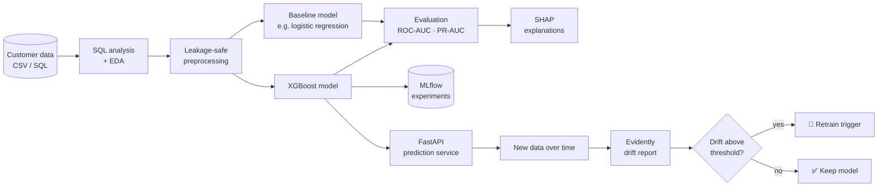

<div align="center">

# 📉 ModelWatch

### Churn prediction that doesn't stop at training — it explains itself and watches its own health

*A model that scores well today can quietly degrade tomorrow. ModelWatch predicts customer churn, explains why, and monitors for data drift so you know when to retrain.*

<br>


[Why](#-why-modelwatch) · [Pipeline](#-pipeline) · [Features](#-features) · [Results](#-results) · [Drift](#-drift-monitoring) · [Quickstart](#-quickstart) · [Roadmap](#-roadmap) · [FAQ](#-faq)

</div>

---

> **📌 Project status — please read**
> ModelWatch is **in active development**. This README describes the **design and goals**.
> The checklist in [Current Status](#-current-status) shows what is actually implemented.
> Result tables are filled in **only after real measurement**.

---

## 🧭 Why ModelWatch?

Losing a customer costs more than keeping one, so companies try to predict who will leave. But a churn model is not "done" once it is trained:

| Common shortcut | The risk | What ModelWatch does |
|---|---|---|
| Report one accuracy number | Hides class imbalance and weak minority-class performance | Reports ROC-AUC and PR-AUC against a baseline |
| Random split on all columns | **Data leakage** makes results look better than reality | Leakage-safe preprocessing and splitting |
| "The model said so" | Business can't act on a black box | SHAP explains which factors drive churn |
| Train once, forget | Customer behaviour changes and the model degrades | Drift monitoring with a retraining rule |
| Notebook only | Nobody else can use the model | API, experiment tracking and Docker |

---

## 🔧 Pipeline



### Step by step

1. **Explore** – SQL queries and EDA to understand churn rate, segments and data quality.
2. **Preprocess safely** – Fit encoders and scalers on training data only, so no test information leaks in.
3. **Baseline first** – Train a simple model so every improvement has something to be compared against.
4. **Train XGBoost** – Tune it and compare it fairly against the baseline.
5. **Explain** – Use SHAP to find the main drivers of churn, globally and per customer.
6. **Track** – Log parameters, metrics and models in MLflow.
7. **Serve** – Expose predictions through a FastAPI endpoint.
8. **Monitor** – Use Evidently to detect data drift and apply a retraining rule.

---

## ✨ Features

| | Feature | What it means |
|---|---|---|
| 🗃 | **SQL analysis** | Business questions answered with queries, not just pandas |
| 🛡 | **Leakage-safe pipeline** | Preprocessing fitted only on training data |
| ⚖️ | **Baseline vs. XGBoost** | Honest comparison on the same split |
| 🔍 | **SHAP explanations** | Global drivers and single-customer explanations |
| 💡 | **Business recommendation** | Findings turned into actions, not just charts |
| 🌊 | **Drift monitoring** | Evidently reports on changing data |
| 🔁 | **Retraining trigger** | A clear rule for when to retrain |
| 🧪 | **Experiment tracking** | MLflow records every run |
| 🔌 | **REST API** | FastAPI prediction endpoint |
| 🐳 | **Docker** | Reproducible environment |


### Business recommendation

`[Write 2–3 actions based on your actual findings, e.g. which segment to target and why.]`

**Known limitations:** `[e.g. single public dataset, no real production traffic, drift is simulated]`

---

## 🌊 Drift monitoring

Drift means the data the model sees in production no longer looks like the data it was trained on.

| Concept | Meaning |
|---|---|
| **Reference data** | The data the model was trained on |
| **Current data** | Newer data arriving after deployment |
| **Data drift** | Feature distributions have shifted |
| **Retraining trigger** | A rule such as "retrain if `[12]` of important features drift" |


## 🚀 Quickstart

```bash
git clone https://github.com/vivekkumarm09/ModelWatch.git
cd ModelWatch

python -m venv venv
source venv/bin/activate        # Windows: venv\Scripts\activate

pip install -r requirements.min.txt   # check this file lists ModelWatch's dependencies
```

> Commands for training, the API and drift reports will be added here once they exist.

---

## 🗂 Project structure

```
ModelWatch/
├── data/                 # download instructions, small samples only              [planned]
├── sql/                  # analysis queries                                        [planned]
├── notebooks/            # EDA and experiments                                     [planned]
├── src/                  # preprocessing, training, evaluation, drift code         [planned]
├── api/                  # FastAPI service                                         [planned]
├── tests/                # pytest tests                                            [planned]
├── Dockerfile                                                                      [planned]
├── pyproject.toml        # packaging and tooling configuration
├── requirements.min.txt  # runtime dependencies
├── requirements.dev.txt  # development dependencies
└── README.md
```

---

## ✅ Current status

Tick a box only when the feature works in this repository.

- [✅] Dataset chosen and documented
- [✅] SQL analysis
- [✅] EDA notebook
- [✅] Leakage-safe preprocessing
- [✅] Baseline model
- [✅] XGBoost model and comparison
- [✅] SHAP explanations
- [✅] Business recommendation written
- [✅] MLflow experiment tracking
- [✅] Evidently drift report
- [✅] Retraining trigger rule
- [✅] FastAPI endpoint
- [✅] Tests and CI
- [✅] Docker image


---

## 🛣 Roadmap

| Phase | Goal | Done when |
|---|---|---|
| 1 | Data, SQL and EDA | Churn patterns documented |
| 2 | Safe preprocessing + baseline | Baseline metrics logged |
| 3 | XGBoost + comparison | Fair comparison on the same split |
| 4 | SHAP + recommendation | Drivers explained in plain English |
| 5 | MLflow + API | Runs tracked; endpoint returns predictions |
| 6 | Drift monitoring | Report generated; trigger rule defined |
| 7 | Tests, Docker, docs | `pytest` passes; container runs |

---

## 🔒 Data and privacy

- Only **public or synthetic** data belongs in this repository.
- No confidential company or customer data is committed.
- Secrets and keys are never stored in the repo.

---

## ❓ FAQ

<details>
<summary><b>Why compare against a baseline?</b></summary>
Without a baseline, you can't tell whether XGBoost actually helped or whether the problem was simply easy.
</details>

<details>
<summary><b>Why PR-AUC as well as ROC-AUC?</b></summary>
When churners are a minority, ROC-AUC can look flattering. PR-AUC focuses on how well the rare class is found.
</details>

<details>
<summary><b>What is data leakage?</b></summary>
When information from the test set (or from the future) influences training, so results look better than they will be in real use.
</details>

<details>
<summary><b>Is the drift real?</b></summary>
Only if you obtain real time-separated data. Otherwise it is simulated, and this README must say so.
</details>

---

## 🤝 Contributing

Issues and pull requests are welcome. Please open an issue first to discuss large changes.


## 🙏 Acknowledgements

Built with open-source tools. Please check each repository for current license terms.

- [Evidently](https://github.com/evidentlyai/evidently) — drift monitoring (Apache-2.0)
- [XGBoost](https://github.com/dmlc/xgboost) — gradient boosting
- [SHAP](https://github.com/shap/shap) — model explanations
- [MLflow](https://github.com/mlflow/mlflow) — experiment tracking

---

<div align="center">

**Built by [Vivek Kumar Mishra](https://github.com/vivekkumarm09)** · If this project helps you, consider giving it a ⭐

</div>
